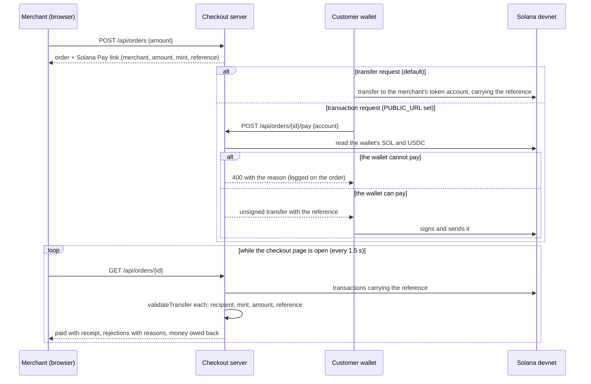

# Solana B5 stablecoin checkout

A checkout that takes payment in a stablecoin on Solana. A merchant creates an order; the customer pays it with a Solana wallet by scanning a Solana Pay QR code; the server finds the payment on chain, checks it and shows a receipt. It runs on devnet only.

This is Deed #5 of The Solana Deeds, a series of one-day learning builds. [Read the write-up](https://reddi.tech/blog/solana-b5-stablecoin-checkout) and [watch the demo](https://youtu.be/gIUIRtcEszs).

This is a source snapshot of `597e2b156f75d9869eb71fef208f39f56354d685`. The private build journal, issue history, evidence files and hosted checks are not part of this repository. Test names and a few comments carry labels such as `B5-002` and `D-11`; they are outcome and decision numbers from that private plan.

## Run it

Install [mise](https://mise.jdx.dev), then:

```sh
mise install
cd app
export PATH="$(mise where node)/bin:$(mise where pnpm):$PATH"
pnpm install --frozen-lockfile
pnpm run ci        # build, typecheck, lint, format check, 38 tests
```

The tests need no funds and no network once the packages are installed. They run against an in-process [Surfpool](https://www.npmjs.com/package/@solana/surfpool) validator, which supports Linux x64 and macOS.

The project refuses any Node other than 22.x, which is why the `PATH` line is there.

**The whole flow on devnet, in one command.** This needs a devnet keypair holding about 0.05 SOL, from [faucet.solana.com](https://faucet.solana.com) for example. Never use a keypair that holds anything of value.

```sh
DEVNET_PAYER_KEYPAIR=~/path/to/devnet-keypair.json pnpm devnet:reproduce
```

The script:

- refuses anything but devnet, and refuses to start if its estimated cost exceeds 0.05 SOL;
- creates a test token with 6 decimals, like USDC (it is not Circle's USDC, so no token faucet is needed), plus a throwaway merchant and customers held only in memory;
- builds and starts this app's production server on a free local port;
- runs four cases through its HTTP API: an order paid in full, an underpayment, an overpayment, and a wallet that cannot pay asking for the transaction;
- prints every signature and explorer link before sending, waits for `finalized`, reads the results back, and reports what it spent in lamports and SOL.

One run spends about 5,572,120 lamports (0.0056 SOL): rent deposits for four new accounts, plus 40,000 lamports in fees. The server always names its token USDC, so its messages say "USDC" even for the test token.

## How it works



- **Pay by QR, confirmed on chain.** Each order gets a Solana Pay link and QR code carrying the merchant, the amount, the USDC mint and a reference unique to the order. The server lists every transaction carrying that reference, checks each with `@solana/pay`'s `validateTransfer`, and marks the order paid by the first that passes. An underpayment, a payment in another token, a transaction that failed on chain, or a signature that already paid another order is rejected, and the reason is logged against the order.
- **Every payment is accounted for.** The receipt shows what actually arrived. An overpayment's excess, a payment made after the order was paid, and the money from a rejected underpayment are listed as owed back, with a total.
- **A wallet that cannot pay is told why.** With a public https address, the QR is a Solana Pay transaction request. The wallet asks the server for the transaction, and the server checks the wallet's SOL and USDC first. A wallet that is short, empty or possibly on another network is refused with a reason before it signs anything, and the checkout page lists it.

The server holds no key; customers sign in their own wallets. `app/README.md` has the file map.

## What was actually proven

Everything below is on devnet, with test money.

- A 12.50 USDC order paid from a phone wallet (Solflare) through a transfer request: [`m8nK1goP…`](https://explorer.solana.com/tx/m8nK1goPxfxCn6QFHo9RNNQoaWd261e6TCfkjN1qPzCE33fsBjjjTHnCeKYbwUVxDma7McPbv3uiYGpmJEqUWL7?cluster=devnet). A second order paid from the checkout's own QR: [`2A4xcXbR…`](https://explorer.solana.com/tx/2A4xcXbRGuxjxX9353ayE7E7ioAND94HER873gdFFjduU4AdBegoYgELnBD6edUjgwBgKqSjtwfWCB2Uqvstw9Sd?cluster=devnet).
- A phone payment through a transaction request: [`5FxSWHLu…`](https://explorer.solana.com/tx/5FxSWHLuwvXaHfTVsU7gGEPrvfYRH4K9A6ShLv9ZjRHn3GkWyTsyeUAFmYruJYLLHPuG4fuD2MQiRTPeK6VHzKg6?cluster=devnet).
- An overpayment (15.00 on a 12.50 order, [`5bX3eXeQ…`](https://explorer.solana.com/tx/5bX3eXeQ3F8tDiHGJVRetdZ2CW7LZUJePdoeKQqo8Ushhx3UhLUaY4Kthnds6QfcGeW3LqKjpG2ZDRYd4j2KconZ?cluster=devnet)) and a second payment to a paid order ([`4akKKaYk…`](https://explorer.solana.com/tx/4akKKaYk7Q75eeShUsm13Bh4wiFVahDRL8NAWT4EpyqR1Z1pAFV1yLPebjXem2fjke4yamufJdxKcyPSBKZxhfiq?cluster=devnet)), both from a scripted test customer, both recorded as owed back.
- Wallets that cannot pay were refused with a reason. Those were scripted test wallets.
- `pnpm devnet:reproduce` passed every check when run from this snapshot before it was published.

Public devnet may prune old transactions, so an explorer link may eventually stop resolving.

## Two bugs found in `@solana/pay`, and the workarounds here

Both are in `validateTransfer` in `@solana/pay` 1.2.0 and are reported upstream:

- [solana-foundation/pay#551](https://github.com/solana-foundation/pay/issues/551): for a transaction that failed on chain it throws a `TypeError`, not a `ValidateTransferError`. Here, a failed transaction is judged from its status before validation.
- [solana-foundation/pay#552](https://github.com/solana-foundation/pay/issues/552): it rejects a transaction-request payment when the wallet appends Compute Budget instructions after the transfer, which the Solana Pay spec allows. Here, trailing Compute Budget instructions, which move no tokens, are dropped before validation. See `app/app/lib/checkout/validation.ts`.

## Why `@solana/pay` comes from a file

Version 1.2.0, the first built on `@solana/kit` 8, is on upstream's main branch but not on npm; npm's newest, 1.0.26, is built on `@solana/kit` 6 and does not install beside this app. So `app/vendor/solana-pay-1.2.0.tgz` is a build of upstream commit `a5c1c83`. No registry published or signed that file. What vouches for it is that you can rebuild it:

```sh
# from the repository root, with the Node and pnpm that mise.toml pins on PATH
scripts/verify-pay-tarball.sh
```

The script checks out that commit, builds and packs the package, and fails unless the result is byte-identical to the committed file. `app/vendor/README.md` mentions a CI job that runs it; that job is in the private repository, and this public copy has no hosted checks.

## Running the checkout yourself

The server reads these environment variables. Only `MERCHANT_ADDRESS` is required, and none is secret.

| Variable | Meaning | Default |
|---|---|---|
| `MERCHANT_ADDRESS` | The merchant's Solana address. Payments go to its USDC token account | none; order creation fails without it |
| `USDC_MINT` | The stablecoin's mint | Circle's devnet USDC, `4zMMC9srt5Ri5X14GAgXhaHii3GnPAEERYPJgZJDncDU` |
| `SOLANA_CLUSTER` | `devnet` or `localnet`. Anything else, mainnet included, is refused | `devnet` |
| `SOLANA_RPC_URL` | RPC endpoint the server reads payments from | the public endpoint for the cluster |
| `CHECK_INTERVAL_MS` | Least time between two chain checks for one order | `1000` |
| `PUBLIC_URL` | The https address wallets reach this server at. When set, the QR is a Solana Pay transaction request served from `/api/orders/{id}/pay` | none: the QR is a transfer request |

```sh
MERCHANT_ADDRESS=<devnet address> pnpm dev   # http://localhost:3000
```

A fresh merchant address is not payable yet: its USDC token account must exist. Older `@solana/pay` releases, which wallets may embed, also refuse a recipient whose main account does not exist, and an address that has never held SOL has none.

Devnet helper scripts (each refuses any RPC that is not devnet):

- `DEVNET_PAYER_KEYPAIR=<path> MERCHANT_ADDRESS=<address> pnpm devnet:merchant-account` creates whatever is missing, paid by the devnet keypair at that path.
- `CUSTOMER_KEYPAIR=<path> pnpm devnet:pay '<solana: link>' [amount]` pays an order as a scripted customer, optionally with a different amount.
- `pnpm devnet:verify-payment <signature> <merchant> <amount> <reference>` reads a payment back at `finalized`, independently of the server, and signs nothing.

Pay from a phone wallet set to devnet, holding devnet SOL for the fee and devnet USDC from [Circle's faucet](https://faucet.circle.com). Solana Pay links carry no network, so a wallet left on mainnet cannot pay a devnet order.

To open the checkout page from another device, run a production server: `pnpm build`, then `MERCHANT_ADDRESS=<address> pnpm start -H 0.0.0.0`. The development server blocks its page scripts for any origin but localhost, so a checkout page opened from a LAN address never turns to paid.

A transaction request needs the server reachable from the phone over https. A tunnel does that, and exposes the server to the internet while it runs; stop it when done.

## Security

- **No key on the server.** It knows the merchant's public address and reads the chain. Customers sign in their own wallets.
- **Devnet only.** `SOLANA_CLUSTER` accepts `devnet` or `localnet`; every devnet script refuses to sign unless the genesis hash is devnet's.
- **The server decides paid, never the browser.** Paid means the transaction succeeded on chain and passed `validateTransfer` for this order, and its signature has paid no other order.
- **No keypair, seed phrase, API key or `.env` file belongs in this repository.** The devnet scripts read a keypair by path and never print it.

This is a learning build. It has not been audited and is not a production setup.

## Limits

- Orders and the amounts owed back live in server memory, and are lost on restart. Refunds are listed, not sent.
- No access control or rate limiting on the API. The pay endpoint and `confirm` call the RPC on every request.
- A page turns to paid at `confirmed`, not `finalized`.
- Each check reads the 25 newest transactions carrying a reference.
- The balance check before signing is advice, not a lock. How a wallet shows a refusal is up to the wallet; the checkout page always shows it.
- One phone wallet was tested (Solflare).
- A second currency and webhooks are not built.

## Licence

MIT. See [LICENSE](LICENSE).
